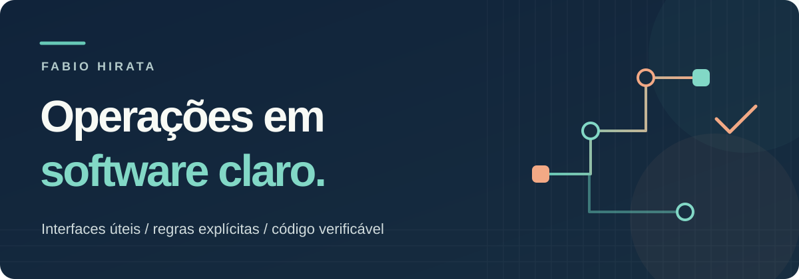
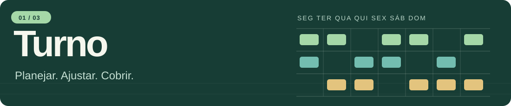
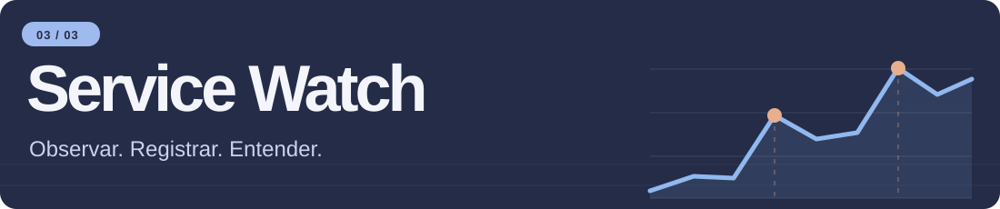

  

  <a href="#projetos">Projetos</a> &nbsp;·&nbsp; <a href="https://fabiohirata.github.io/fabio-hirata-site/">Site pessoal e contato ↗</a> &nbsp;·&nbsp; <a href="#english">English</a> &nbsp;·&nbsp; <a href="#日本語">日本語</a>

Transformo rotinas de operação em ferramentas que você pode explorar: interfaces claras, regras testáveis e decisões documentadas. Os três projetos abaixo mostram a experiência no navegador e o código por trás dela.

## Projetos selecionados

### Turno · Planejamento de equipes

Uma escala semanal que cruza **disponibilidade, cobertura e carga horária**. A interface aponta lacunas e atribuições que precisam de revisão. Na demonstração, você pode ajustar turnos, resolver conflitos e exportar a escala.

**Go · JavaScript** — API REST com persistência JSON atômica, revisões otimistas e testes de contrato. A demo pública usa dados fictícios e roda sem o backend; o modo API é executado localmente.

**[Explorar a demo ↗](https://fabiohirata.github.io/turno-shift-planner/)** &nbsp;·&nbsp; [Código e arquitetura](https://github.com/FabioHirata/turno-shift-planner) &nbsp;·&nbsp; [Testes](https://github.com/FabioHirata/turno-shift-planner/blob/main/docs/QA.md)

Ver captura real da interface · Turno

Modo API Go executado localmente, com dados fictícios.

---

### Forno · Encomendas e capacidade diária

Um balcão para uma padaria fictícia. **Catálogo, preço, produção do dia e andamento dos pedidos** ficam no mesmo fluxo. Você pode criar uma encomenda, testar o limite diário e acompanhar seu status.

**JavaScript · HTML · CSS** — regras de domínio isoladas, valores em ienes inteiros e dados versionados no navegador. Cancelar libera capacidade; reativar exige nova validação. O CSV exportado tem proteção contra fórmulas.

**[Explorar a demo ↗](https://fabiohirata.github.io/forno-order-desk/)** &nbsp;·&nbsp; [Código e decisões](https://github.com/FabioHirata/forno-order-desk) &nbsp;·&nbsp; [Testes](https://github.com/FabioHirata/forno-order-desk/blob/main/docs/QA.md)

Ver captura real da interface · Forno

---

### Service Watch · Observações e incidentes

Uma central que reúne **indicadores, janelas de observação e histórico de incidentes**. Na demonstração, você pode explorar métricas ilustrativas e registrar a evolução de um incidente.

**Python · SQLite · JavaScript** — coletor HTTP e API locais, armazenamento transacional e frontend responsivo. A coleta real é manual, limitada a destinos permitidos e preserva as observações mesmo após o encerramento de um incidente. A demo pública usa dados fictícios.

**[Explorar a demo ↗](https://fabiohirata.github.io/service-watch/)** &nbsp;·&nbsp; [Código e arquitetura](https://github.com/FabioHirata/service-watch) &nbsp;·&nbsp; [Testes](https://github.com/FabioHirata/service-watch/blob/main/docs/QA.md)

Ver captura real da interface · Service Watch

---

### O fio condutor

**Regras de negócio explícitas · Interfaces responsivas · PT / EN / 日本語 · Testes de domínio · Decisões documentadas**

As demos públicas funcionam no navegador com cenários fictícios. GitHub Pages não executa os backends Go e Python; cada repositório explica como rodá-los localmente. Estes são projetos de portfólio, sem alegação de clientes ou serviços em produção. Não insira dados pessoais nas demos.

<strong>English · Explore the projects</strong>

## Practical tools for everyday operations

I turn operational workflows into clear interfaces, testable rules and tools you can explore.

- **[Turno](https://github.com/FabioHirata/turno-shift-planner)** — Weekly shift planning with availability and coverage checks. Go REST API, atomic JSON persistence, optimistic revisions and a JavaScript frontend. [Try the demo](https://fabiohirata.github.io/turno-shift-planner/).
- **[Forno](https://github.com/FabioHirata/forno-order-desk)** — A fictional bakery order desk with pricing, daily capacity, order statuses and CSV export. JavaScript with isolated business rules and browser storage. [Try the demo](https://fabiohirata.github.io/forno-order-desk/).
- **[Service Watch](https://github.com/FabioHirata/service-watch)** — A Python HTTP collector/API, transactional SQLite storage and a JavaScript incident dashboard. Manual local collection preserves observations separately from incident history. [Try the demo](https://fabiohirata.github.io/service-watch/).

All three interfaces support Portuguese, English and Japanese. Public demos use fictional data; GitHub Pages does not run the Go or Python backends. Local setup, tests and limitations are documented in each repository. These are portfolio projects, not claimed client deployments or production services.

[Personal website and contact](https://fabiohirata.github.io/fabio-hirata-site/)

<strong>日本語 · プロジェクトを見る</strong>

## 日々の業務を、わかりやすいツールに

業務の流れを、使いやすい画面と検証可能なルールを備えたツールにしています。デモとソースコードから、実装と設計の考え方をご覧いただけます。

- **[Turno](https://github.com/FabioHirata/turno-shift-planner)**：勤務可能な時間帯と必要人数を確認できる週間シフト管理。GoのREST API、アトミックなJSON保存、同時編集の競合検出、JavaScriptの画面を備えています。[デモを開く](https://fabiohirata.github.io/turno-shift-planner/)。
- **[Forno](https://github.com/FabioHirata/forno-order-desk)**：架空のベーカリーの注文管理。料金計算、日別の生産枠、注文状況、CSV出力をまとめています。JavaScriptの業務ロジックを画面処理から分離し、データはブラウザに保存します。[デモを開く](https://fabiohirata.github.io/forno-order-desk/)。
- **[Service Watch](https://github.com/FabioHirata/service-watch)**：PythonのHTTPコレクター・API、SQLite、JavaScriptを組み合わせたサービス状況・インシデント管理。ローカル環境で手動収集し、観測データと対応履歴を分けて保存します。[デモを開く](https://fabiohirata.github.io/service-watch/)。

3つの画面はポルトガル語・英語・日本語に対応しています。公開デモは架空データを使用します。GitHub PagesではGo・Pythonのバックエンドは動作しません。ローカルでの実行方法、テスト、制約は各リポジトリに記載しています。実際の顧客向け導入事例や本番サービスを示すものではありません。

[個人サイト・お問い合わせ](https://fabiohirata.github.io/fabio-hirata-site/)

